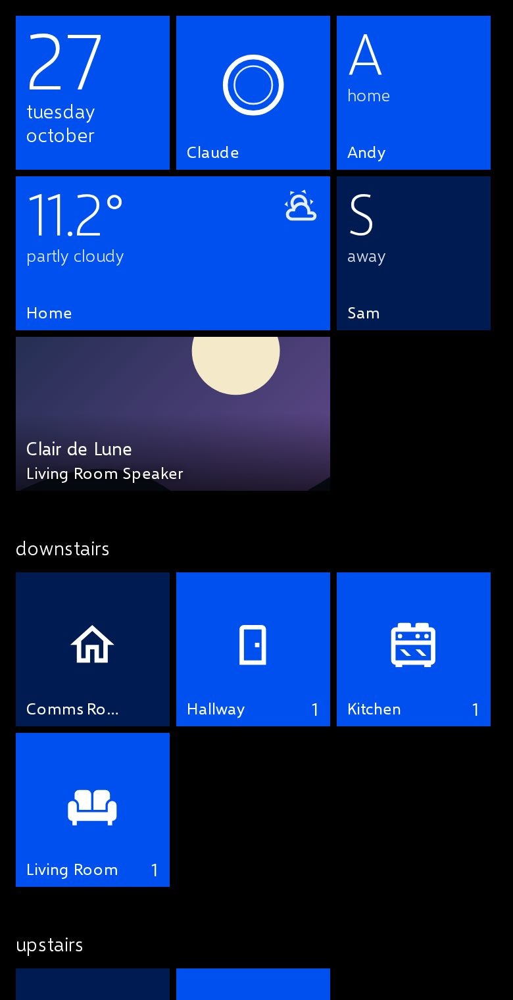
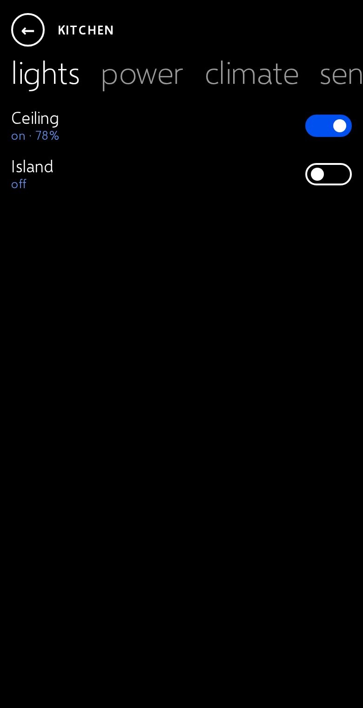
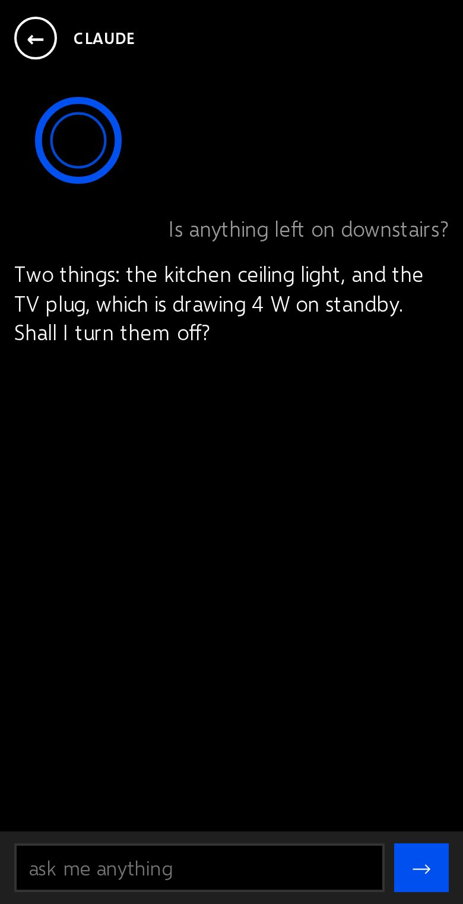
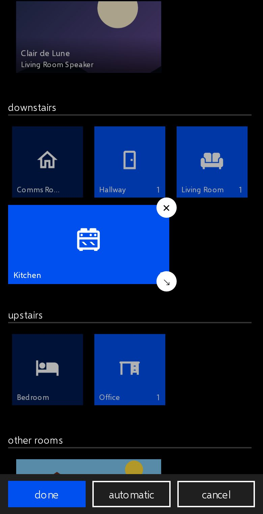
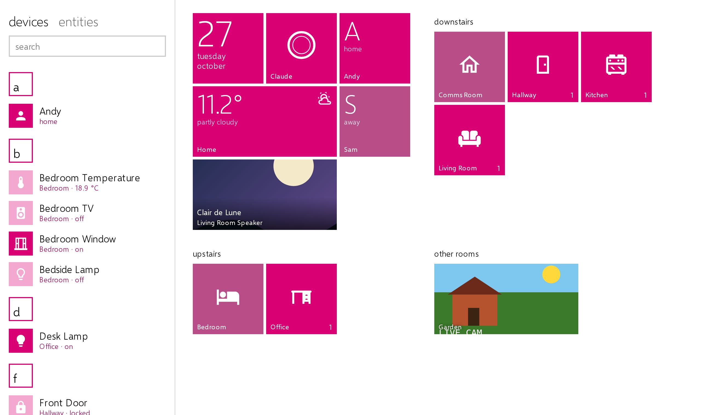

# Mosaic

A live-tile Start screen for Home Assistant, after Windows Phone 10.

**[Try it on a demo home →](https://housefly.vome.io/mosaic)** No account needed: the link signs you in as a guest on a simulated house hosted by [Vome](https://vome.io), so tap away. It works best on a phone.

<p>




</p>


- **Live tiles:** small, medium, wide and large tiles in one accent colour. They flip or peek between faces: a room turns over to its temperature or what's playing, the date to your next event, a camera tile shows its picture.
- **Rooms are apps:** tap a room tile for a full-screen room with pivots (lights, power, climate, media, security...) that you swipe between. Tapping a name opens Home Assistant's own dialog.
- **The A–Z list:** swipe left (on a desktop it sits beside the tiles) for everything in the house, with search and a letter jump list. It lists **devices** (a smart plug is one row, not five sensors; tap it to open it like a room) or every **entity**: switch at the top, and each viewer's choice is remembered.
- **An assistant where Cortana was:** a tile and the search box talk to your home's Assist agent. If that agent is Claude (the Anthropic integration), the tile says Claude. When the Assist pipeline has speech-to-text there is a microphone too, and with text-to-speech, spoken questions get spoken answers. It all goes through Home Assistant's own pipeline (Whisper, Home Assistant Cloud, whatever you set up there), never a browser speech service.
- **No setup:** with no config, Mosaic lays your home out from its floors and areas.
- **Customise it like a phone:** hold a tile and Start comes loose. Drag tiles to move them (drag to the top or bottom edge and Start scrolls), tap ↘ to resize, ✕ to unpin, type over a group's name to rename it, *+ group* for a new one, then *done*. Hold anything in the list to *pin to start*. *automatic* goes back to the layout Mosaic picks. Changes are saved into the dashboard, so only admins can make them.

## Install

**Home Assistant 2026.11 and later (the Marketplace):** Mosaic is waiting to join the catalogue. Until then, add `https://github.com/Vortitron/mosaic` as a custom repository of type *Dashboard* in Settings → Marketplace. Custom repositories need GitHub connected there, and only get update checks while it is.

**Earlier versions, with HACS:** add the same address as a custom repository of type *Dashboard*, then download Mosaic.

Either way the card's resource is registered for you.

**By hand:** download `mosaic.js` from the [latest release](https://github.com/Vortitron/mosaic/releases/latest) into `/config/www/mosaic/`, and add `/local/mosaic/mosaic.js` as a JavaScript module resource (Settings → Dashboards → ⋮ → Resources).

### Make a Mosaic dashboard

Settings → Dashboards → *Add dashboard* → *New dashboard from scratch*. Open it, choose ⋮ → *Raw configuration editor*, and replace everything with:

```yaml
strategy:
  type: custom:mosaic
```

From then on the pencil (*Edit dashboard*) opens Mosaic's settings: accent colour, theme, the assistant and the rest. To change the tiles, hold one on the dashboard itself.

Or add a *Mosaic Start* card to a view of your own; panel views suit it best.

## Options

```yaml
type: custom:mosaic-start
accent: cobalt          # lime green emerald teal cyan cobalt indigo violet pink magenta
                        # crimson red orange amber yellow brown olive steel mauve taupe, or '#rrggbb'
theme: auto             # dark | light | auto (follows Home Assistant)
columns: 6              # small-tile columns on a phone: 6 (three medium tiles across) or 8
list: devices           # what the A–Z list starts on: devices | entities
light_colours: false    # true: a lit lamp's tile takes the lamp's colour
wallpaper: /local/me.jpg  # or an image.* / camera.* entity: seen through the tiles, as on Windows Phone 10
assistant:              # false hides the assistant
  agent_id: conversation.claude   # default: your preferred Assist pipeline's agent
  name: Claude
  voice: true                    # the microphone, when the pipeline can hear
  speak: true                    # spoken answers to spoken questions
groups:                 # leave out to have Mosaic lay the home out itself
  - name: downstairs
    tiles:
      - area: kitchen     # a room tile; tap opens the room
        size: wide        # small | medium | wide | large
      - entity: light.sofa
      - entity: camera.garden
        size: wide
      - type: clock       # clock | assistant | media (whatever is playing) | settings
        calendars: [calendar.family]   # the date tile's next event: only these calendars
```

Tap a tile to toggle it, or to open its room. Holding a tile customises Start (admins), or opens Home Assistant's dialog for it (everyone else; `editable: false` makes that the rule for admins too). Locks, alarms and climate never act on a tap; they open the dialog instead. A switch that looks like it runs the house (servers, a fridge, a boiler, an EV charger and the like) asks before it switches.

## Let Claude lay it out

The auto layout is a start. If Claude can reach your home (the Vome MCP, or any Home Assistant MCP server that can save dashboards), ask it something like *"Make me a Mosaic start screen: the rooms I use most as wide tiles, the kettle and the front door on the first screen."* It writes the `groups:` above and saves the dashboard. Nothing in the card needs to change for that.

## Privacy

Mosaic makes no requests outside your Home Assistant. Its typeface (Selawik) is bundled inside the card, and the assistant goes through Home Assistant's Assist, so the only AI that hears you is the one you set up there.

## Credits

- Typeface: [Selawik](https://github.com/microsoft/Selawik), © Microsoft, SIL Open Font License 1.1 (`fonts/OFL.txt`). It is Segoe UI's open-source stand-in; where Segoe UI is installed, it is used instead.
- Prior art: [Metrology](https://github.com/Madelena/Metrology-for-Hass) by Madelena, the Metro theme for Home Assistant.

Mosaic is not affiliated with Microsoft. Windows Phone and Cortana are Microsoft trademarks.

## Developing

```sh
npm install
npm run build        # dist/mosaic.js
npm test             # the model, in node
python3 -m http.server 18766   # then open /tools/harness/ (fake home; ?theme=light&accent=lime&cols=8)
```

`tools/hatest.cjs`, `tools/listtest.cjs` and `tools/haedittest.cjs` drive a real Home Assistant with Playwright (login, room toggle, Assist, the device list, saving a customised Start). `tools/edittest.cjs` runs the customising against the harness, and `tools/editortest.cjs` opens the settings in a real Home Assistant. `tools/readme-shots.cjs` remakes these screenshots from the harness. `tools/voicetest.cjs` speaks to a real pipeline through Chromium's fake microphone; it needs a speech-to-text engine that takes mono audio (Home Assistant's demo one only takes stereo, which Assist never sends).
