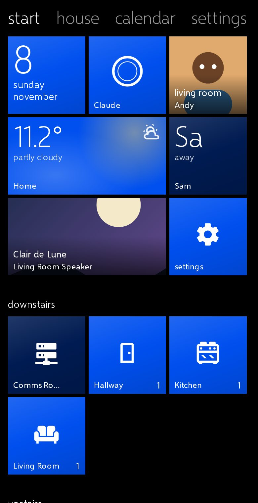
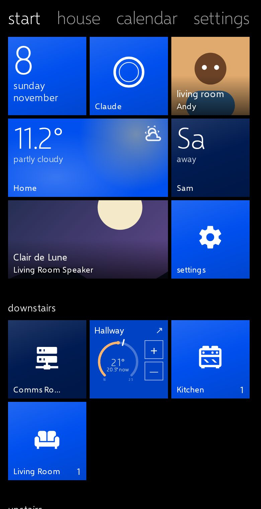
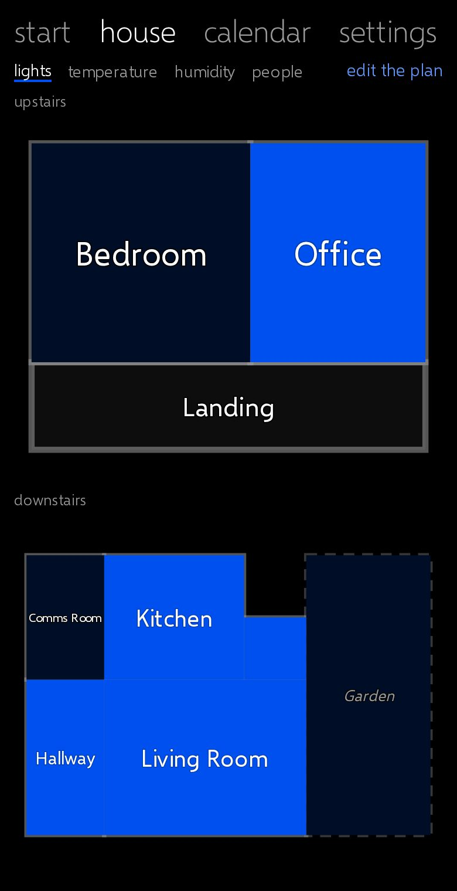
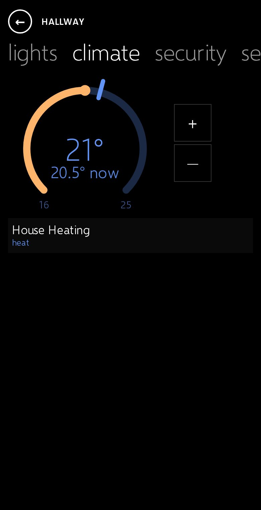
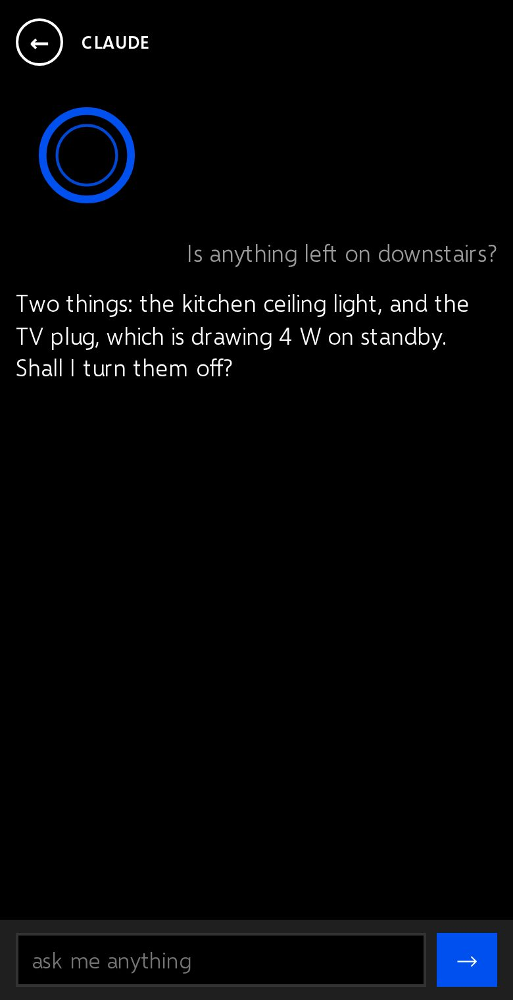
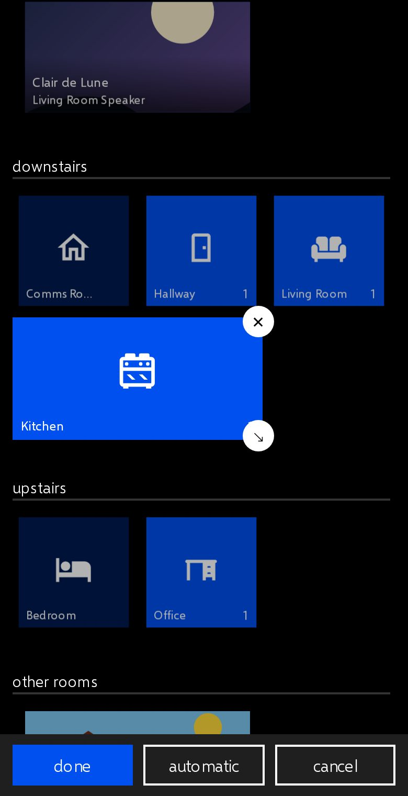
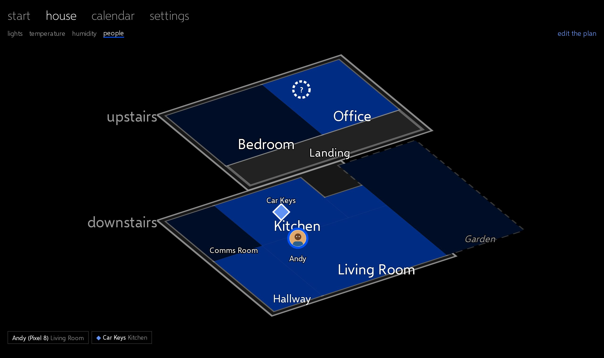
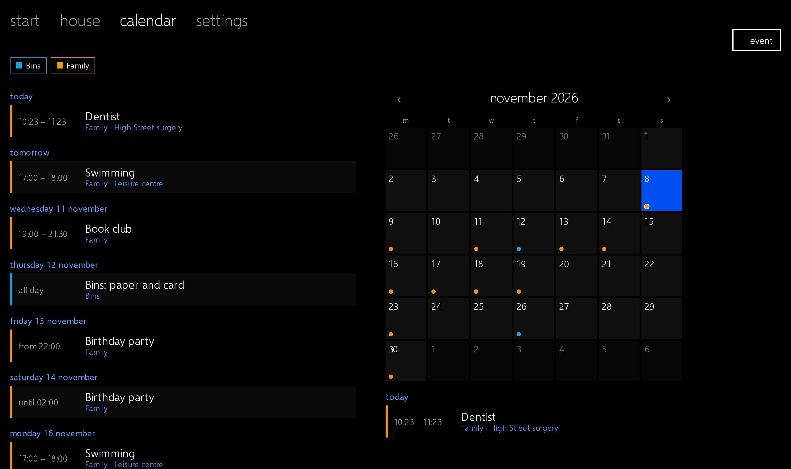
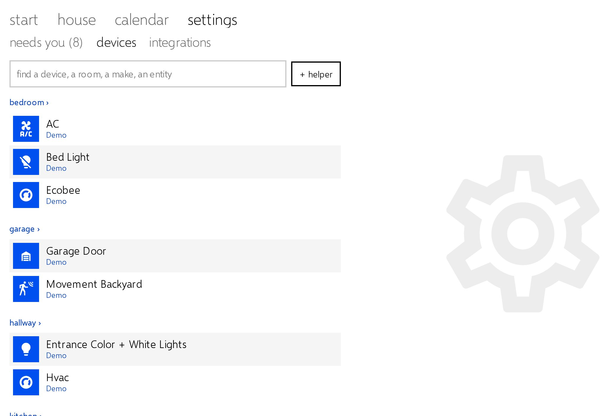
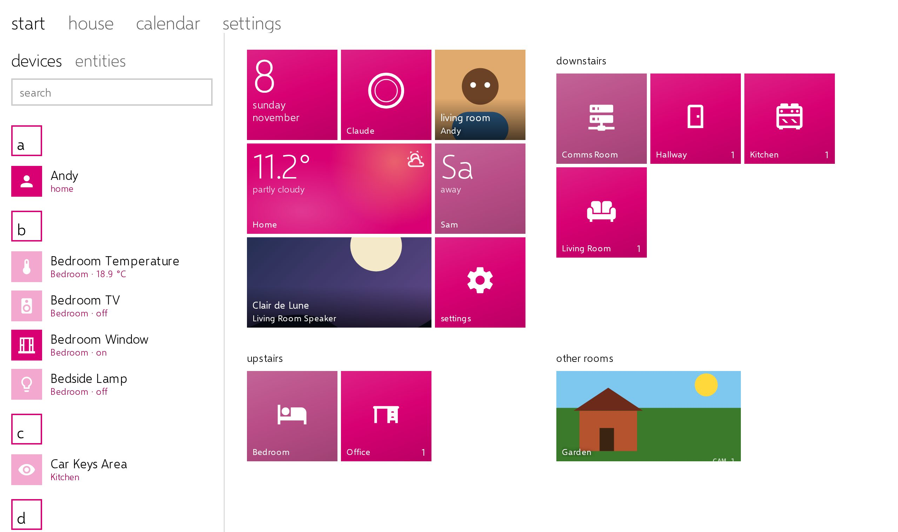

# Mosaic

A live-tile Start screen for Home Assistant, after Windows Phone 10.

**[Try it on a demo home →](https://housefly.vome.io/mosaic)** No account needed: the link signs you in as a guest on a simulated house hosted by [Vome](https://vome.io), so tap away. It works best on a phone.

<p>




</p>
<p>


</p>





- **Live tiles:** small, medium, wide and large tiles in one accent colour. They flip or peek between faces: a room turns over to its temperature or what's playing, the date to your next event, a camera tile shows its picture.
- **Tiles turn over:** tap a tile and it flips to its controls: a lamp's switch and brightness, a room's lights and plugs, play/pause and volume, a thermostat's setpoint, a blind's open/stop/close. Tap the face again to go in. (`tap: act` brings back one-tap toggling.)
- **Heating on the back:** a room you can heat turns over to a gauge: what it is set to, large, with the room's temperature on the arc, and a step warmer or cooler beside it (quick taps add up and go as one change). It uses a thermostat in the room, or whatever you pick on the room's settings page (a water heater, or a setpoint helper an automation heats to); the same page picks which of the room's own sensors give its temperature and humidity. A thermostat whose setting an automation drives from a *desired temperature* helper (`input_number.<thermostat>_desired_temperature`) is set through that helper, so your automation doesn't undo it. A thermostat's own tile turns over to the same gauge, and a room's climate pivot opens on it.
- **Tabs:** *start*, *house*, *energy*, *calendar* and *settings* along the top, as pivot headers (on a phone the row slides). Tap the one you're on to go back to its top.
- **Energy:** what the house is drawing from the grid now, the price now with the day's spot prices and the cheapest hour still to come, how much it has used today (hour by hour, and what that cost), which rooms are using power now, and what each device has used today, with devices counted inside another shown under it. It reads Home Assistant's own Energy dashboard setup and statistics, so its numbers agree with that dashboard. *not in a room* lists what uses power with no room set, and lets an admin give each one a room.
- **The calendar:** an agenda of the month ahead and a month you can page through (side by side on a desktop), each calendar in its own colour; tap the chips to choose which show (each viewer's choice is kept). Tap an event for its details, and delete it where the calendar allows; *+ event* adds one to a calendar that takes them (Local Calendar, Google, CalDAV and others). The date tile opens it.
- **The house, drawn:** the *house* tab is your floor plan, coloured by which lights are on, the temperature or the humidity. On a wide screen the floors are stacked and tilted, and pointing at one lifts it; on a phone they sit flat, one above the other, as big as the screen allows. Pinch (or use the wheel) to zoom in on a small room and drag to move about; *fit* puts it back. A *people* view shows who is where (see below). The *cameras* view lays each room's camera stills (and the artwork of whatever is playing) on its floor, refreshed every ten seconds; pinch in to look closer. Cameras whose room isn't drawn are in a row under the plan. The *energy* view colours each room by the power it is using now, with the rooms listed under the plan, most first. It takes its devices from Home Assistant's Energy dashboard when you have set that up (each counted once, even where one is inside another), and otherwise from the power sensors in each room, leaving out grid meters, limits and forecasts. Tap a room to open it.
- **Rooms are apps:** tap a room tile for a full-screen room with pivots (lights, power, climate, media, security...) that you swipe between. Tapping a name opens Home Assistant's own dialog. A camera's still fades in over the last one and says when it is from (for a snapshot camera that hasn't changed, *same since …*); tap it for the live view.
- **The A–Z list:** swipe left (on a desktop it sits beside the tiles) for everything in the house, with search and a letter jump list. It lists **devices** (a smart plug is one row, not five sensors; tap it to open it like a room) or every **entity**: switch at the top, and each viewer's choice is remembered.
- **Numbers read as bars:** in the A–Z list, a number with a range (a setpoint, a fade time, a battery or humidity in %) shades its row as far as its value.
- **An assistant where Cortana was:** a tile and the search box talk to your home's Assist agent. If that agent is Claude (the Anthropic integration), the tile says Claude. When the Assist pipeline has speech-to-text there is a microphone too, and with text-to-speech, spoken questions get spoken answers. It all goes through Home Assistant's own pipeline (Whisper, Home Assistant Cloud, whatever you set up there), never a browser speech service.
- **Settings, device first:** admins get a *settings* tab (and tile) that replaces Home Assistant's Integrations, Devices, Entities and Helpers pages. Find the thing first, not the integration it came from: devices by room (newly found ones at the top), every integration A–Z with its logo, rooms by floor, and what needs you (failed set-ups, repairs, updates). Rename, move, hide, add helpers and integrations without a page load.
- **Made for a phone:** everything you tap is thumb-sized, the tabs fit a narrow screen, the phone's back button closes the room or event you have open rather than leaving the dashboard, and a swipe turns the calendar's month.
- **No setup:** with no config, Mosaic lays your home out from its floors and areas.
- **Customise it like a phone:** hold a tile and Start comes loose. Drag tiles to move them (drag to the top or bottom edge and Start scrolls), tap ↘ to resize, ✕ to unpin, type over a group's name to rename it, *+ group* for a new one, then *done*. Hold anything in the list to *pin to start*. *automatic* goes back to the layout Mosaic picks. Changes are saved into the dashboard, so only admins can make them.

## Install

**Home Assistant 2026.11 and later:** open Settings → Marketplace, search for **Mosaic** and install it.

**Earlier versions, with HACS:** open HACS, search for **Mosaic** and download it.

Either way the card's resource is registered for you.

**From the repository, if the search doesn't find it** (an older HACS catalogue, say): add `https://github.com/Vortitron/mosaic` as a custom repository of type *Dashboard* in the Marketplace or HACS, then install Mosaic from there. On the Marketplace, custom repositories need GitHub connected, and only get update checks while it is.

**By hand:** download `mosaic.js` from the [latest release](https://github.com/Vortitron/mosaic/releases/latest) into `/config/www/mosaic/`, and add `/local/mosaic/mosaic.js` as a JavaScript module resource (Settings → Dashboards → ⋮ → Resources).

### Make a Mosaic dashboard

Settings → Dashboards → *Add dashboard* → *New dashboard from scratch*. Open it, choose ⋮ → *Raw configuration editor*, and replace everything with:

```yaml
strategy:
  type: custom:mosaic
```

From then on the pencil (*Edit dashboard*) opens Mosaic's settings: accent colour, theme, the assistant and the rest. To change the tiles, hold one on the dashboard itself.

Or add a *Mosaic Start* card to a view of your own; panel views suit it best.

## Options

```yaml
type: custom:mosaic-start
accent: cobalt          # lime green emerald teal cyan cobalt indigo violet pink magenta
                        # crimson red orange amber yellow brown olive steel mauve taupe, or '#rrggbb'
theme: auto             # dark | light | auto (follows Home Assistant)
columns: 6              # small-tile columns on a phone: 6 (three medium tiles across) or 8
list: devices           # what the A–Z list starts on: devices | entities
light_colours: false    # true: a lit lamp's tile takes the lamp's colour
wallpaper: /local/me.jpg  # or an image.* / camera.* entity: seen through the tiles, as on Windows Phone 10
assistant:              # false hides the assistant
  agent_id: conversation.claude   # default: your preferred Assist pipeline's agent
  name: Claude
  voice: true                    # the microphone, when the pipeline can hear
  speak: true                    # spoken answers to spoken questions
tap: flip               # flip: a tap shows the controls on the back | act: a tap toggles or opens
tile_style: soft        # soft (a gentle wash) | flat (solid accent, the old look)
rooms:                  # per room (set from the room's settings page)
  office:
    heating: input_number.office_setpoint   # what the room tile turns over to
settings: true          # false hides the settings tab and tile (they are only ever shown to admins)
brand_icons: true       # false: integrations get a letter instead of their logo from brands.home-assistant.io
show_plan: true         # false: no house tab
show_calendar: true     # false: no calendar tab (it shows when the home has calendars)
show_energy: true       # false: no energy tab (it shows when the home has an Energy dashboard or power sensors)
plan_view: stack        # stack (floors tilted on top of each other, on wide screens) | flat
floorplan_from: my-plan # a dashboard whose config holds a floor plan (see below)
floorplan:              # or the plan itself; false turns plans off
groups:                 # leave out to have Mosaic lay the home out itself
  - name: downstairs
    tiles:
      - area: kitchen     # a room tile; tap opens the room
        size: wide        # small | medium | wide | large
      - entity: light.sofa
      - entity: camera.garden
        size: wide
      - type: clock       # clock | assistant | media (whatever is playing) | settings
        calendars: [calendar.family]   # the date tile's next event: only these calendars
```

Tap a tile to turn it over to its controls, and tap its face again to open it. Holding a tile customises Start (admins), or opens Home Assistant's dialog for it (everyone else; `editable: false` makes that the rule for admins too). Locks, alarms and climate never act on a tap; they open the dialog instead. A switch that looks like it runs the house (servers, a fridge, a boiler, an EV charger and the like) asks before it switches.

## The floor plan

With no plan, Mosaic sketches one from your floors and areas: each floor a block of rooms, sized by how much is in them, with gardens down one side. It says it is a sketch. An admin taps *draw it properly* to open the editor:

- drag rooms to move them, drag a corner to resize, *+ part* for L-shaped rooms, and pick which Home Assistant area each room is;
- add a backdrop (a photo or scan of your plan, uploaded to Home Assistant) and trace over it;
- or *import* a plan as JSON, in [house.wad](https://github.com/Vortitron/house.wad)'s format.

*Save* writes the plan into this dashboard's config. Nothing goes in `/config/www`, which anyone can read without signing in.

A plan looks like this (metres; `rects` are `[x1, y1, x2, y2]`):

```yaml
floorplan:
  levels:
    up: { floor: 2.7 }
  rooms:
    - { id: kitchen, name: Kitchen, area: kitchen, rects: [[0, 0, 4, 3.5]] }
    - { id: bedroom, name: Bedroom, area: bedroom, level: up, rects: [[0, 0, 4, 4]] }
  scanners:              # optional: where each Bluetooth listener is (by its name in Bermuda)
    Kitchen Proxy: [3.8, 0.2]
  radars:                # optional: mmWave presence sensors, by entity prefix
    - { radar: office_radar, at: [5.2, 0.2], facing: 45, level: up }   # facing: degrees
```

### Who is where

The plan's *people* view puts people and things in the room they're in:

- **People** are shown with their picture from Home Assistant, or their initials.
- **Phones** that broadcast a beacon (the companion app's *BLE transmitter* sensor) and are followed by [Bermuda](https://github.com/agittins/bermuda) are shown as the person whose phone it is, placed by their distance to each listener. Listeners the plan doesn't place count as the middle of their device's room. The room is held for a minute and a half when the reading drops out.
- **Things** with a Bermuda or `mqtt_room` area sensor (car keys, a tag on the dog) are shown as diamonds. Tap one in the list underneath to find it.
- **Radar presence sensors** (LD2410, LD2450) listed under `radars:` show where someone is. If a phone is in that room, it's them; if not, a *?* says someone is there.

People tiles say which room they're in too, plan or no plan.

## Let Claude lay it out

The auto layout is a start. If Claude can reach your home (the Vome MCP, or any Home Assistant MCP server that can save dashboards), ask it something like *"Make me a Mosaic start screen: the rooms I use most as wide tiles, the kettle and the front door on the first screen."* It writes the `groups:` above and saves the dashboard. Nothing in the card needs to change for that.

## Privacy

Mosaic makes no requests outside your Home Assistant. Its typeface (Selawik) is bundled inside the card, and the assistant goes through Home Assistant's Assist, so the only AI that hears you is the one you set up there.

## Credits

- Typeface: [Selawik](https://github.com/microsoft/Selawik), © Microsoft, SIL Open Font License 1.1 (`fonts/OFL.txt`). It is Segoe UI's open-source stand-in; where Segoe UI is installed, it is used instead.
- Prior art: [Metrology](https://github.com/Madelena/Metrology-for-Hass) by Madelena, the Metro theme for Home Assistant.

Mosaic is not affiliated with Microsoft. Windows Phone and Cortana are Microsoft trademarks.

## Developing

```sh
npm install
npm run build        # dist/mosaic.js
npm test             # the model, in node
python3 -m http.server 18766   # then open /tools/harness/ (fake home; ?theme=light&accent=lime&cols=8)
```

`tools/hatest.cjs`, `tools/listtest.cjs` and `tools/haedittest.cjs` drive a real Home Assistant with Playwright (login, room toggle, Assist, the device list, saving a customised Start). `tools/edittest.cjs` runs the customising against the harness, `tools/touchtest.cjs` the phone gestures (pinch, drag, back, swipe) with real touch events, `tools/camtest.cjs` the cameras and energy views and a camera's still fading in without moving the page, `tools/energytest.cjs` the energy tab and giving something a room, and `tools/editortest.cjs` opens the settings in a real Home Assistant. `tools/readme-shots.cjs` remakes these screenshots from the harness, and `tools/readme-settings-shot.cjs` the settings one from a real Home Assistant (the harness has no device registry). The local Home Assistant serves its own copy of the card (`config/www/mosaic/mosaic.js`): copy `dist/mosaic.js` there before running the tests against it, or they test an old build. `tools/voicetest.cjs` speaks to a real pipeline through Chromium's fake microphone; it needs a speech-to-text engine that takes mono audio (Home Assistant's demo one only takes stereo, which Assist never sends).
